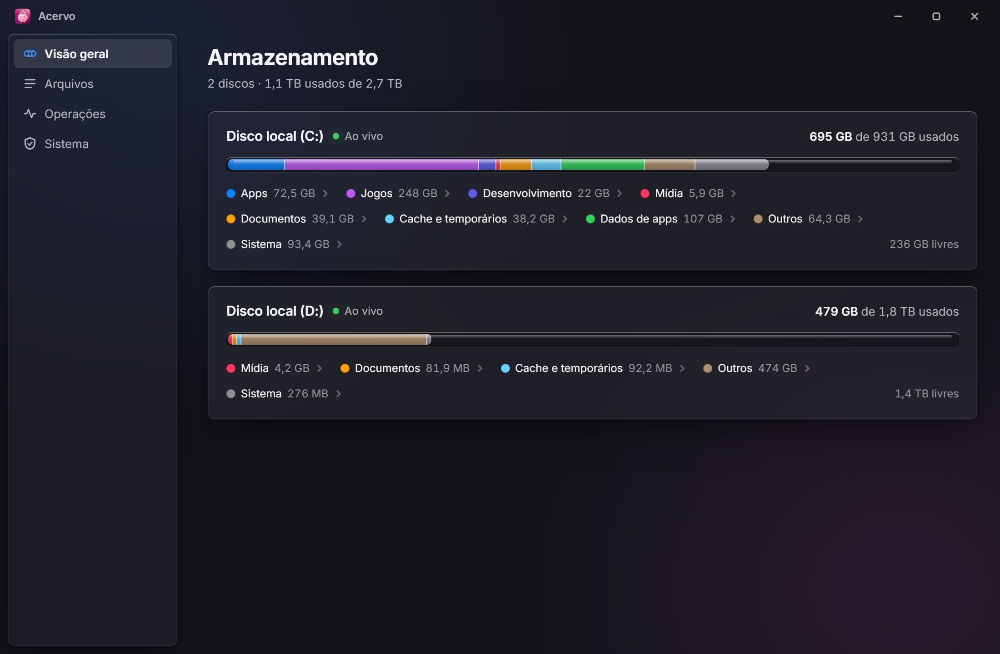
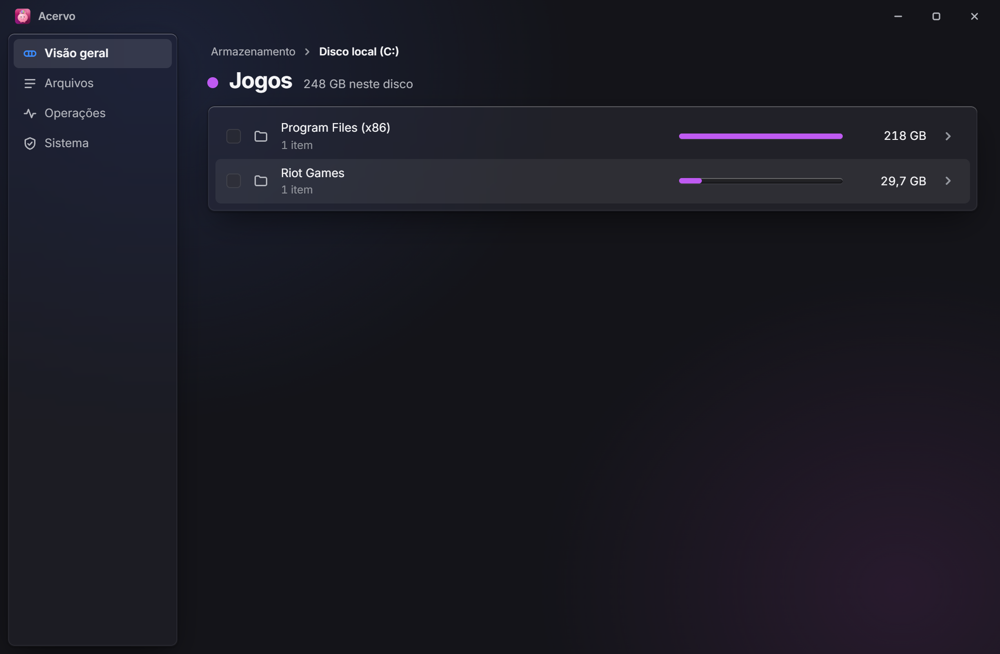
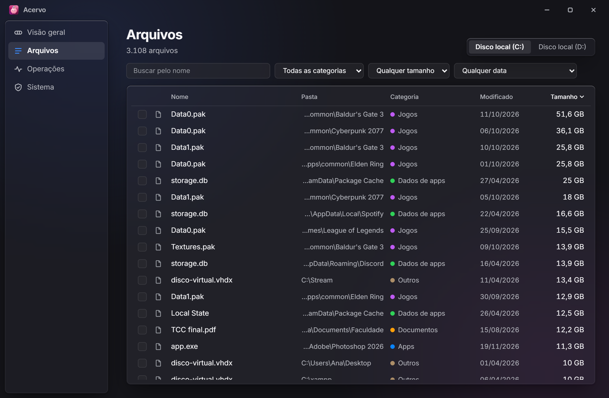

<p align="center">
  
</p>

<p align="center">
  <b>O armazenamento do PC mostrado como no iPhone.</b><br>
  Um app de Windows em Tauri, Rust e React que lê a MFT do NTFS, separa cada disco em 10 categorias e deixa agir sobre o que encontrar.
</p>

<p align="center">
  <a href="#como-rodar">Como rodar</a> ·
  <a href="docs/README.md">Documentação</a> ·
  <a href="docs/categorias.md">Categorias</a> ·
  <a href="https://eduardohenrique-nu.vercel.app">Portfólio</a>
</p>

<p align="center"></p>

<p align="center">
  
</p>

<p align="center">
  
  
</p>

<p align="center"><sub>As capturas usam discos e arquivos de exemplo, gerados pela própria interface fora do app.</sub></p>

## O que é

A tela de armazenamento do Windows mostra pouco: o que não foi instalado pelo jeito oficial cai em "Outros", e jogos de launchers, caches e restos de programas desinstalados somem no meio. O Acervo faz pelo PC o que a tela "Armazenamento" do iPhone faz pelo celular:

- **Visão geral.** Uma barra por disco, dividida em 10 categorias: Apps, Jogos, Desenvolvimento, Mídia, Documentos, Downloads, Cache e temporários, Dados de apps, Sistema e Outros.
- **Rápido.** Lê a Master File Table do NTFS direto, sem percorrer pasta por pasta, e cataloga um disco de 1 TB em segundos. Por isso pede permissão de administrador ao abrir.
- **Ao vivo.** Acompanha o diário de mudanças do NTFS (USN Journal): criar, apagar ou mover um arquivo muda a barra em menos de um segundo.
- **Reabre rápido.** Guarda um snapshot do índice ao fechar e, ao abrir de novo, reaplica só o que mudou.
- **Dá para agir.** Entrar em cada categoria, ver todos os arquivos do disco do maior ao menor (ou do menor ao maior), filtrar, e mandar para a Lixeira, apagar de vez, mover, copiar, renomear ou abrir no Explorer.
- **Com segurança.** O que é do Windows não pode ser mexido, mexer em arquivos de um programa instalado pede confirmação, e toda operação fica registrada em log.

## Como rodar

Precisa de Windows 10 ou 11, Rust (toolchain MSVC) e Node 22+.

```bash
git clone https://github.com/eduardohenrique-dev/acervo.git
cd acervo
npm install
npm --prefix ui install
npm run tauri dev
```

Em modo desenvolvimento o app roda **sem** administrador e usa uma varredura por pastas, mais lenta, sem as áreas protegidas e sem o ao vivo. O app completo vem do instalador:

```bash
npm run tauri build
```

O instalador sai em `target/release/bundle/nsis` e pede administrador ao abrir. O passo a passo está em [instalação e uso](docs/instalacao-e-uso.md).

A interface sozinha também abre no navegador, com discos de exemplo: `npm --prefix ui run dev` (porta 5199).

## Testes

```bash
cargo test --workspace
npm --prefix ui exec -- vitest --run
```

São cerca de 130 testes em Rust (classificação, leitura da MFT e do USN, árvore, snapshot, política de operações) e 26 na interface. Veja [desenvolvimento](docs/desenvolvimento.md) para os exemplos que rodam contra um disco de verdade.

## Como é por dentro

```
crates/
  classify/   as 10 categorias e as regras que decidem a categoria de cada caminho
  index/      leitura da MFT, varredura por pastas, árvore em memória, consultas e USN Journal
  store/      snapshot do índice e a decisão de reaproveitá-lo ao abrir
  ops/        operações pela IFileOperation do Windows, política do que pode ser mexido e log
src-tauri/    o app: análise dos discos, vigia ao vivo, fila de operações, comandos
ui/           interface em React, TypeScript e Tailwind (liquid glass)
```

A visão completa está em [arquitetura](docs/arquitetura.md).

## Documentação

- [Instalação e uso](docs/instalacao-e-uso.md)
- [Categorias](docs/categorias.md)
- [Ao vivo e snapshot](docs/ao-vivo-e-snapshot.md)
- [Operações e segurança](docs/operacoes.md)
- [Arquitetura](docs/arquitetura.md)
- [Design](docs/design.md)
- [Desenvolvimento](docs/desenvolvimento.md)

## Roadmap

- Desinstalar programas com faxina dos restos (pastas e registro, com backup `.reg`).
- Mover apps para outro disco com junção, recomendando o próprio launcher para jogos da Steam, Epic e Riot.

## Coletânea Quintal

O Acervo faz parte do Quintal, três apps de Windows com a mesma família visual: cada um tem um bicho e uma cor. O porquinho rosa é o Acervo; a coruja violeta é o [Penumbra](https://github.com/eduardohenrique-dev/penumbra); o gato preto em âmbar é o [Palco](https://github.com/eduardohenrique-dev/palco).

---

<sub>Feito em Governador Valadares (MG). Código publicado para consulta; todos os direitos reservados.</sub>
